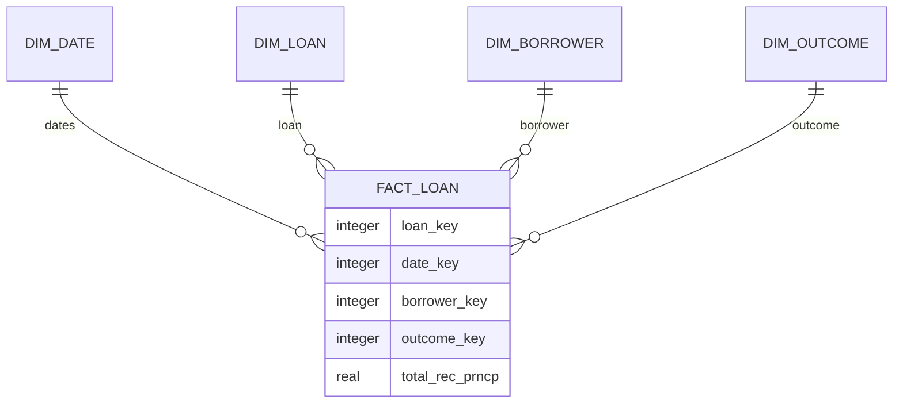

# Agentic RAG over a Lending Club Financial Data Mart

This course project implements a reproducible local workflow for the public
[All Lending Club loan data](https://www.kaggle.com/datasets/wordsforthewise/lending-club)
dataset. It is based on the attached CS7050 project proposal. Kaggle data is
downloaded manually, never by the application, and must not be committed or
uploaded.

## Proposal scope and implementation

Confirmed proposal requirements implemented here:

- Select approximately 100,000 accepted Lending Club records from 2015–2018.
- Preserve `annual_inc`, `dti`, `revol_util`, `fico_range_low`, `loan_amnt`,
  `int_rate`, `term`, `installment`, `grade`, `loan_status`, and
  `total_rec_prncp`.
- Build a SQLite star-schema teaching implementation with date, loan,
  borrower, outcome, and fact tables; PostgreSQL is documented as the intended
  production adaptation rather than a required local dependency.
- Retain settled outcomes: `Fully Paid` and `Charged Off`.
- Train a decision-tree default classifier and a linear-regression principal
  recovery model for charged-off loans.
- Serve guarded text-to-SQL through FastAPI.
- Provide a readable browser analysis UI and a secondary complete JSON payload.
- Avoid generating arbitrary SQL: only allowlisted templates are used.

Assumptions and limitations:

- The proposal's 2015–2018 range and 100K limit are preserved deterministically.
- “Expected recovery”/LGD is approximated from `total_rec_prncp` on Charged Off
  records; without loss-given-default-specific fields, this is a project
  baseline rather than a financial-loss estimate.
- The proposal named PostgreSQL. This implementation uses SQLite for portable
  offline tests and can be adapted by replacing connection management and
  preserving the star schema.
- NRP GPU deployment is an optional proposal recommendation, not a current
  dependency. No customized LLM is downloaded or required.
- The query layer is template-based. The proposal's golden-benchmark target is
  represented by tested sample questions, not an external LLM benchmark.
- The real Kaggle file, 100K database, credentials, and model artifacts are
  intentionally excluded from source control.

## Prepare and load data manually

Download the Kaggle CSV yourself and keep it outside the repository.

```bash
python -m lending_club.cli prepare \
  /absolute/path/accepted_2007_to_2018Q4.csv \
  data/loans.csv

python -m lending_club.cli load \
  data/loans.csv \
  data/lending_club.db

python -m lending_club.cli train \
  data/loans.csv \
  artifacts/
```

Preparation keeps 2015–2018 records, settled statuses, and exactly up to
100,000 deterministically sampled records with seed 42. It normalizes percent
and term fields and rejects rows missing required values.

## Schema



## Run the API and UI

```bash
uvicorn lending_club.api:app --reload
```

Open `http://127.0.0.1:8000/`. The main panel shows a readable answer,
summary cards, a chart, and a formatted table. `Complete JSON response` remains
available as a secondary details panel. `POST /query` returns `answer`,
`summary`, `sql`, `columns`, and `rows`.

## Documented sample questions

Each sample below is deterministic and covered by `tests/test_lending_club.py`:

- What is the average loan amount by grade?
- What is the average interest rate by grade?
- What is the average interest rate by grade and loan status?
- What is the average interest rate by loan status?
- How many loans were issued by year?
- What is the default rate by year?
- What is the average annual income by grade and loan status?
- What is the average annual income by loan status?
- What is the average DTI by loan status?
- What is the average FICO score by loan status?
- What is the total principal received by loan status?
- What is the total principal received by grade?
- What is the total principal received by year?

## Tests

```bash
python -m pip install -e .
pytest -q
```

The offline fixtures contain no Kaggle data. If `data/lending_club.db` exists,
the real database can be smoke-tested with:

```bash
python - <<'PY'
from lending_club.rag import answer_question
r = answer_question("What is the default rate by year?", "data/lending_club.db")
print(r["answer"])
print(r["columns"])
print(r["rows"][:10])
PY
```

## Proposal deviations

- PostgreSQL and GPU tools are proposal milestones but are not runtime
  dependencies of this offline implementation.
- The original baseline did not include `grade` or `total_rec_prncp`; both are
  now preserved through preparation and the star schema.
- The original baseline used a logistic/ridge loan-amount model; it has been
  aligned to the proposal with a decision tree and linear recovery model.
