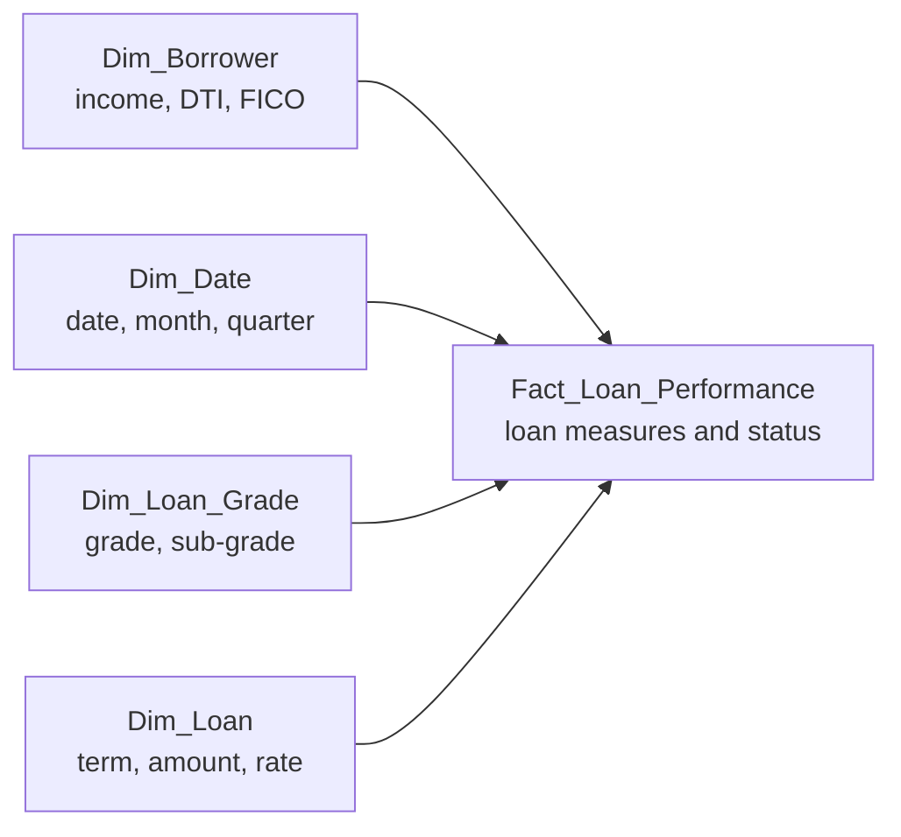
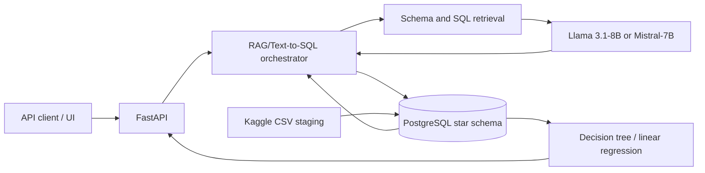
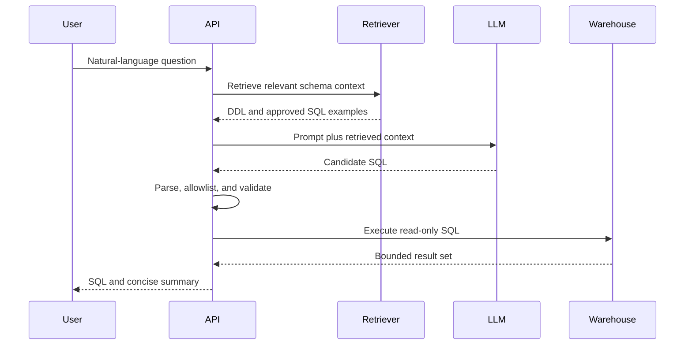

# CS 7050 Project Report

**Agentic Retrieval-Augmented Generation (RAG) over a Financial Data Mart**

> This Markdown version is a readable companion to the IEEE-style LaTeX report in `docs/report.tex`.

## Title and Author
- Author: **Bhavani Patangay**
- Institution: Department of Computer Science, Kennesaw State University
- Course: CS 7050 — Data Warehousing and Data Mining
- Section: 01
- Location: Marietta, U.S.A.
- Email: bpatanga@students.kennesaw.edu

## Abstract
This project proposes an end-to-end platform combining a PostgreSQL financial data mart, traditional machine-learning models, and agentic RAG for Lending Club loan-performance analysis. The proposed model uses a fact table linked to borrower, loan, grade, and date dimensions. A temporal evaluation reports decision-tree classification and linear-regression results: the classifier achieves 0.8003 accuracy and 0.2002 recall on the 2018 holdout, while regression results are mixed against a mean baseline. A FastAPI/RAG service remains proposed; its implementation and benchmark are not verified here. This report distinguishes supplied model metrics from unverified end-to-end implementation and dataset artifacts.

**Keywords:** Data warehousing, star schema, Lending Club, decision trees, linear regression, PostgreSQL, FastAPI, retrieval-augmented generation, text-to-SQL

## I. Introduction
Business stakeholders need portfolio answers across loan grade, origination period, borrower profile, status, and repayment outcome. Static dashboards cannot readily support changing ad hoc questions. This project separates storage from interaction: PostgreSQL stores dimensional analytical data, scikit-learn provides interpretable/predictive models, and RAG translates natural-language questions into audited SQL.

## II. Problem Statement
Stakeholders require visibility into loan risk, charge-offs, and exposure, but business users may not know complex SQL. Static dashboards are inflexible.

The research question is whether a PostgreSQL star schema, conventional machine-learning models, and schema-grounded RAG can be integrated to answer Lending Club portfolio questions accurately and transparently. The scope is decision support, not real-world credit approval.

## III. Dataset and Selection
The proposed dataset is the Kaggle “All Lending Club Loan Data” release. The proposal selects approximately 100,000 records issued from 2015 through 2018. The exact source release and CSV remain unverified in this checkout; the model-evaluation split is reported in Section VII.

| Area | Attributes | Use |
|---|---|---|
Loan | loan_amnt, int_rate, term, installment | Exposure, pricing, payment burden |
Grade | grade, sub_grade | Risk segmentation |
Borrower | annual_inc, dti, revol_util, fico_range_low | Risk features |
Outcome | loan_status | Fully paid versus charged-off target |
Recovery | total_rec_prncp | Recovery-oriented outcome |
Time | issue_d, last_pymnt_d | Cohort and trend analysis |

The selection must exclude post-issuance fields from issue-time default prediction to prevent leakage. Missing values, target definitions, and exact source release must be documented.

## IV. Data Mart and Star Schema



The fact grain is one loan record. A typical implementation uses surrogate keys for borrower, grade, loan, and date dimensions.

| Table | Column | Type | Key/Null | Definition |
|---|---|---|---|---|
Fact_Loan_Performance | loan_key | BIGINT | PK, NN | Loan surrogate key |
| Fact_Loan_Performance | borrower_key | BIGINT | FK, NN | Borrower reference |
| Fact_Loan_Performance | grade_key | BIGINT | FK, NN | Grade reference |
| Fact_Loan_Performance | issue_date_key | INTEGER | FK, NN | YYYYMMDD date key |
| Fact_Loan_Performance | loan_amnt | NUMERIC | NN | Funded principal |
| Fact_Loan_Performance | status | VARCHAR | NN | Paid or charged-off analytic status |
| Fact_Loan_Performance | total_rec_prncp | NUMERIC | Nullable | Principal received |
| Dim_Borrower | annual_inc | NUMERIC | Nullable | Annual income |
| Dim_Borrower | dti | NUMERIC | Nullable | Debt-to-income ratio |
| Dim_Borrower | fico_range_low | INTEGER | Nullable | FICO range lower bound |
| Dim_Loan_Grade | grade | CHAR(1) | NN | Loan grade |
| Dim_Date | date_key | INTEGER | PK | YYYYMMDD date key |

## V. Data Preparation/ETL
The planned pipeline extracts the selected CSV, profiles missing values, normalizes status labels, converts dates and percentages, deduplicates loans, generates dimension keys, loads dimensions, and loads fact rows transactionally. Validation includes source/target counts, required-key null checks, referential integrity, date-range checks, duplicate-key checks, and principal reconciliation.

**Status:** ETL implementation is not present or verified.

## VI. Proposed Architecture



The generated SQL is parsed and validated as read-only, restricted to approved entities, executed with limits and timeouts, and summarized only after the result set is available.



## VII. Machine Learning Models and Metrics
### Decision-Tree Default Classification
A decision tree was evaluated for distinguishing fully paid from charged-off loans. The temporal split trains on 93,642 loans from 2015–2017 and evaluates on an untouched 2018 holdout of 6,358 loans. The classification threshold, 0.397727, was selected by maximizing out-of-fold (OOF) recall subject to a 77% OOF-accuracy floor. At that threshold, training OOF accuracy is 0.7714, recall is 0.2303, and F1 is 0.3075.

- Precision = TP / (TP + FP)
- Recall = TP / (TP + FN)
- F1 = 2TP / (2TP + FP + FN)
- Accuracy = (TP + TN) / (TP + TN + FP + FN)
- ROC-AUC = area under the true-positive-rate versus false-positive-rate curve

The confusion matrix below lists rows as actual negative/positive and columns as predicted negative/positive.

| 2018 holdout measure | Selected threshold 0.397727 | Majority baseline | Earlier max-F1 threshold 0.229 |
|---|---:|---:|---:|
| Accuracy | 0.8003 | 0.8413 | 0.6291 |
| Precision | 0.3038 | — | — |
| Recall | 0.2002 | 0 | 0.6571 |
| F1 | 0.2413 | 0 | 0.3599 |
| ROC-AUC | 0.6869 | 0.5000 | — |
| AP (PR-AUC) | 0.2671 | 0.1587 | — |
| Confusion matrix | [[4886, 463], [807, 202]] | — | — |

The selected threshold trades some accuracy for positive-class detection relative to the majority baseline, but recall remains modest. The earlier max-F1 threshold has higher recall and F1 but substantially lower accuracy; these operating points show the accuracy–recall tradeoff, not overall superiority. The proposal's numeric threshold-compliance criterion has not been verified and is not claimed.

### Linear Recovery Regression
Linear regression was evaluated for a recovery-related outcome against a mean-prediction baseline.

- R² = 1 - Σ(y_i - ŷ_i)² / Σ(y_i - ȳ)²

| Measure | Linear regression | Mean baseline |
|---|---:|---:|
| MAE | 3011.69 | 3156.40 |
| RMSE | 3796.35 | 3464.18 |
| R² | -3.311 | -2.589 |

The model has lower MAE but higher RMSE and a more negative R² than the baseline, indicating a weak, mixed fit rather than overall improvement.

## VIII. RAG/Text-to-SQL Methodology
The knowledge base contains DDL, relationships, data types, approved SQL examples, and metric definitions. Retrieval selects relevant context, then the model generates one read-only statement. A 40-query benchmark is proposed for syntax success, schema entity match, result-set match, and end-to-end latency.

| Metric | Formula or comparison |
|---|---|
SQL execution success | Executable read-only queries / attempts |
Schema entity match | Correct referenced entities / required entities |
Result-set match | Normalized result rows compared exactly |
Latency | Response time minus request time |

The benchmark, model deployment, and metrics are **planned, not measured**.

## IX. Implementation and API/UI
Technology: FastAPI, PostgreSQL, Python, pandas, psycopg2 or SQLAlchemy, scikit-learn, and optional NRP GPU model execution. The project should remain usable if an external model endpoint is unavailable.

Implemented layout:
```text
docs/report.tex
docs/report.md
docs/report.pdf
lending_club/
tests/test_lending_club.py
pyproject.toml
data/             # Local-only and Git-ignored
artifacts/        # Local-only and Git-ignored
```

Setup and run:
```bash
python3 -m venv .venv
source .venv/bin/activate
python -m pip install -e .
python -m lending_club.cli prepare /external/path.csv data/loans.csv
python -m lending_club.cli load data/loans.csv data/lending_club.db
python -m lending_club.cli train data/loans.csv artifacts/
uvicorn lending_club.api:app --reload
```

Example prompts:
```text
What is the total loan amount charged off by loan grade in 2017?
Show the quarterly trend of fully paid and charged-off loans.
Which FICO bands have the highest charge-off rate?
What principal was recovered by grade and issue year?
```

## X. Experimental Setup and Results
The reported temporal evaluation trains on 93,642 loans from 2015–2017 and evaluates on an untouched 2018 holdout of 6,358 loans. The model metrics are reported above. The underlying Kaggle CSV, model artifact, execution log, and full implementation are not present in this worktree, so the results cannot be independently reproduced from this checkout. The RAG benchmark and full API/data-mart implementation remain unverified.

| Item | Verified status |
|---|---|
Dataset source | Proposed in the proposal |
Temporal model split | 93,642 training; 6,358 holdout (2018) |
Decision-tree metrics | Reported in this report |
Recovery-regression metrics | Reported in this report |
Raw dataset and model artifacts | `[PLACEHOLDER: not present for independent reproduction]` |
PostgreSQL schema | `[PLACEHOLDER: not implemented]` |
40-query benchmark | `[PLACEHOLDER: not implemented]` |
FastAPI deployment | `[PLACEHOLDER: not implemented]` |

## XI. Evaluation
Evaluation combines warehouse correctness, model validity, and RAG usefulness. The reported temporal model results show a classifier threshold tradeoff and mixed recovery-regression performance against a mean baseline; underlying files are needed for independent reproduction.

- Reconcile load counts, principal totals, and foreign keys.
- Compare held-out model metrics against simple baselines.
- Compare prompt-only text-to-SQL with retrieval-augmented text-to-SQL.
- Measure normalized result-set match and latency.
- Separate automated SQL correctness from executive-summary quality.

## XII. Limitations and Future Work
The Kaggle source may contain incomplete or inconsistent historical labels. The subset is not representative of every lender or current behavior. Missing data, class imbalance, and survivorship effects can bias results. Results must not be used for individualized credit decisions.

LLMs may hallucinate fields or produce incorrect SQL. Mitigations include read-only execution, statement allowlisting, parsing, row limits, timeout, and human review. Future work includes incremental ETL, slowly changing dimensions, test suites, dashboards, retrieval evaluation, audit logs, model monitoring, fairness analysis, and confidence reporting.

## XIII. Conclusion
The proposal defines a coherent financial data-mart and agentic RAG project, with a star schema for OLAP-style analysis and a proposed FastAPI interface. The supplied temporal evaluation reports measurable but qualified model results: the selected decision threshold favors an accuracy constraint over higher recall, while recovery regression improves MAE but not RMSE or R² versus the mean baseline. The full data mart, API, RAG benchmark, and raw artifacts remain unverified in the inspected checkout; the model metrics therefore require their source artifacts for independent reproduction.

## References
1. N. George, “All Lending Club Loan Data,” Kaggle, 2019. https://www.kaggle.com/datasets/wordsforthewise/lending-club
2. P. Lewis et al., “Retrieval-Augmented Generation for Knowledge-Intensive NLP Tasks,” NeurIPS, 2020, pp. 9459–9474.
3. T. Hastie, R. Tibshirani, and J. Friedman, *The Elements of Statistical Learning*, 2nd ed., Springer, 2009.
4. F. Pedregosa et al., “Scikit-learn: Machine Learning in Python,” JMLR, vol. 12, pp. 2825–2830, 2011.
5. S. Ramírez, “FastAPI.” https://fastapi.tiangolo.com/
6. R. Kimball and M. Ross, *The Data Warehouse Toolkit*, 3rd ed., Wiley, 2013.
7. PostgreSQL Global Development Group, “PostgreSQL Documentation.” https://www.postgresql.org/docs/
8. Meta AI, “Llama 3.1 Model Card,” 2024. https://llama.meta.com/
9. A. Rajkumar et al., “Evaluating Text-to-SQL Capabilities of Large Language Models,” arXiv:2204.00498, 2022.
